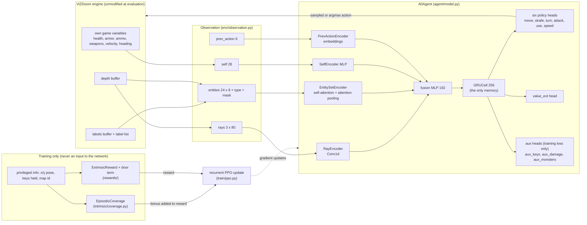

# DoomsDay: a recurrent agent for DOOM on unseen maps

Hackathon entry for Track 1, "Can It Play DOOM?". The agent plays DOOM through the
ViZDoom engine. It reads ego-centric sensor data (depth rays, visible entities, its own
status), keeps a recurrent memory, and picks every action with a neural network. The
model, the PPO trainer, the reward terms, the map generator, the curriculum and the
evaluation harness are our own code, written during the event.

> **Status (written 2026-11-25, before the final runs).** On generated walking-only
> (S0) training maps the best imitation model beats a random policy (18/40 against
> 4/40). On unseen val S0 maps the gain over random is not significant (6/15 against
> 3/15), and every model scored 0/15 on val maps with doors (S1), keys (S2) and
> monsters (S3) (`reports/eval/2026-11-25-bc-dagger.md`). No held-out report exists in
> `reports/eval/`. Sections marked **TODO** must be filled before submission.

Detailed documents:
- [`docs/ARCHITECTURE.md`](docs/ARCHITECTURE.md): observation contract, model, trainer,
  imitation stage, rewards, maps and curriculum.
- [`docs/COMPLIANCE.md`](docs/COMPLIANCE.md): each hackathon rule, the code that
  addresses it, and the latest audit verdict.

---

## 1. Problem

The agent must finish DOOM levels it has never seen: walk through several rooms, open
doors, find a keycard and go back to its locked door, survive monsters, and reach the
exit. It sees only what is in its field of view (partial observability). Rewards are
sparse: the exit is often hundreds of decisions away. The final evaluation runs on the
unmodified engine with vanilla rules, so nothing the agent needs at inference may depend
on a training-time aid.

## 2. Architecture

The deliverables of the brief map to our code as follows.

| Deliverable | Where in the code |
|---|---|
| Sensory and state representation | `env/observation.py` (`rays`, `entities`, `ego_motion`, `self_vector`), `env/doom_env.py` (`DoomEnv._build_obs`) |
| Model, memory, variable number of enemies | `agent/encoders.py` (`RayEncoder`, `EntitySetEncoder`, `SelfEncoder`, `PrevActionEncoder`), `agent/model.py` (`A0Agent`) |
| Training, reward shaping, exploration | `train/` (our recurrent PPO; behaviour cloning in `train/bc.py`), `rewards/terms.py`, `rewards/doors.py`, `intrinsic/coverage.py`, `curriculum/`, `maps/`, `teachers/` (training-time only) |



Components, named as in the code. All are our own design and code, composed from
standard PyTorch layers (`Conv1d`, `Linear`, `MultiheadAttention`, `GRUCell`):

- **`RayEncoder`**: two 1-D convolution layers over 3 bands x 80 columns of depth rays,
  then a linear layer to 64 values.
- **`EntitySetEncoder`**: handles a variable number of visible entities (0 to 24). Each
  entity is a type embedding joined to its 8 features, passed through a shared MLP to a
  64-value token. A learned "no entity" token is always present. One masked multi-head
  self-attention block (4 heads) with a residual connection, then a learned query
  pools the tokens. There is no positional encoding, so row order does not matter.
- **`SelfEncoder`** and **`PrevActionEncoder`**: an MLP on the 28-value self vector;
  one embedding table per action head, summed.
- **Fusion and memory**: an MLP to 192 values, then a `GRUCell` with 256 units. The
  hidden state is zeroed at episode start. The GRU is the only memory in the code.
- **Heads**: six categorical policy heads, one extrinsic value head (`value_ext`), and
  training-only heads `value_int`, `aux_keys`, `aux_damage`, `aux_monsters`. Nothing
  reads the auxiliary heads to choose an action. `value_int` exists but is not used
  by the PPO loss: the coverage bonus is summed into the reward instead.
- **Curiosity / exploration**: `EpisodicCoverage` (`intrinsic/coverage.py`) is a
  reward-side, count-based bonus. It is not a network module. A learned novelty module
  (`intrinsic/learned_novelty.py`) is described in its docstring as **not built**.

The model has 474,474 parameters (`reports/runs/2026-11-25-first-doom-run-a0-4x8.md`,
Stage A0 model as of the first run). **TODO-VERIFY**: the count changes if observation
v2 (below) adds inputs.

## 3. Observation design and why it generalizes

Every input comes from what the player can perceive in the current frame, plus its own
status. Details and exact shapes are in `docs/ARCHITECTURE.md`.

- **Depth rays** (`rays`, 3 x 80): the nearest depth per 2-pixel column in three
  horizontal bands around the horizon, from the rendered depth buffer. The player's own
  weapon sprite and firing overlay are masked out.
- **Entities** (`entities`, up to 24 rows of 8 features): from the labels buffer. Per
  visible object: screen-box centre and size, mean depth of its own visible pixels, the
  change of position and depth since the last decision, and a "new" flag. Its type
  (monster, projectile, health, key colour, ...) comes from the engine class name. A
  label with no visible pixel of its own is dropped. If more than 24 are visible, the
  nearest 24 are kept.
- **Self vector** (`self`, 28): health, armor, ammo of the selected weapon, damage
  since the last decision, selected and owned weapons, and body-frame motion (forward,
  sideways and vertical speed, turn since the last decision).
- **Previous action** and a 3-value **modality** flag (telemetry present or not).

Why this prevents memorizing a map:
- No absolute position, absolute heading, map name, sector id or seed is in the
  observation. Position and map name go to a separate `info` dict that is used only
  for rewards, logging, curriculum and auxiliary labels (`DoomEnv._build_info`).
- The absolute heading is used only to rotate the agent's own velocity into its body
  frame; the angle itself is not output (`ego_motion`).
- The view is ego-centric and partial: rays and entities exist only for what is
  rendered in the current frame. No automap and no whole-level object or sector list is
  read (`objects_info` and `sectors_info` are off, and `assert_vanilla` refuses them).

**Observation v2 (in progress, TODO-VERIFY).** A line-of-sight door channel and key
bits are being added tonight. They are **not in the code** at the time of writing
(nothing in `env/` or `agent/` mentions them). They will change the observation spec,
so checkpoints trained before v2 will be refused by `evaluate.run` against a v2 env.

## 4. Training pipeline and curriculum

The pipeline has three stages. Only the first two use the scripted teacher.

1. **Scripted teacher data** (`teachers/`, training-time only). A waypoint controller
   with Dijkstra route planning over the generated map's geometry and the privileged
   pose drives the player through S0-S2 training maps. It outputs actions in the
   agent's own six-head action space. Random "noise bursts" are executed while the
   teacher's label is recorded. This code uses a pathfinder and trigonometry; it is
   never imported by `agent/`, `env/` or `evaluate/` (test:
   `tests/test_teachers_isolation.py`). Whether the organizers accept a scripted teacher
   for imitation is an open question (see `docs/COMPLIANCE.md`).
2. **Behaviour cloning and DAgger** (`train/bc.py`, `teachers/collect.py --student`).
   The A0 model is trained with per-head cross-entropy on teacher labels, with
   truncated backpropagation through time. In DAgger rounds the student drives, the
   teacher labels every state, and the union of all data is re-cloned.
3. **Recurrent PPO** (`train/ppo.py`, `train/trainer.py`, `train/run_doom.py`). Our own
   PPO: clipped objective, GAE, whole-sequence minibatches recomputed from stored GRU
   states, entropy bonus on the summed head entropies, auxiliary losses. It can start
   from an imitation model (`--init-from`), with value-only warm-up updates
   (`--value-warmup-updates`). Defaults in `configs/train_config.py` (`PPOConfig`):
   rollout 64, 4 minibatches, 3 epochs, clip 0.2, lr 3e-4, gamma 0.997, GAE lambda 0.95,
   entropy coefficient 0.01.

**Reward terms** (`rewards/terms.py`, presets in `configs/reward_config.py`,
`--shaping full_level` or `full_level_doors`). Computed from `info` only, never from
the action or observation: level exit 1.0 (paid only when the engine's exit reward
agrees), keycard 0.1 per colour, kill 0.02, damage taken -0.003 per point, health
0.002, ammo 0.005 per 10 units, armor 0.001, death -0.75, time -0.0002 per decision.
The repeatable positive terms are capped at 0.4 per episode. `full_level_doors` adds a
door term of 0.3, paid once per door the first time the player passes through it
(`rewards/doors.py`, uses map geometry and pose).

**Exploration signal** (`intrinsic/coverage.py`). A 128-unit grid over the map; the
first visit to a cell in an episode pays 1/64, for at most 64 cells. The coefficient
falls linearly from 0.25 to 0.05 over 60,000 decisions per environment. It uses the
privileged x/y pose, for reward only.

**Maps and curriculum.** `maps/generator.py` is our own seeded generator of
vanilla-format PWADs (rooms on a 32-unit lattice, DR doors, keyed doors, exit line or
switch, monsters and pickups; no ACS). Batch 1 has 80 train, 20 val and 20 held-out
maps over four stages: S0 navigation, S1 doors, S2 key and locked door, S3 monsters and
pickups (`reports/runs/2026-11-25-maps-batch1.md`). `curriculum/scheduler.py` picks a
training map per episode. Promotion: when the last 200 episodes on the current stage
reach the stage's threshold (S0 0.6, S1 0.6, S2 0.5), the agent moves to the next stage;
afterwards 20% of episodes replay an earlier stage. `curriculum/config.json` labels
these thresholds as unmeasured placeholders.

**Engine modifications used in training only.**
- The first run trained on ViZDoom's bundled `my_way_home` scenario, whose WAD carries
  its own ACS reward script and skill setting.
- Training on generated maps uses our own PWAD maps with vanilla rules and no ACS, and
  vanilla engine reward knobs only (`generated_maps_env_config`).
- Privileged engine data (pose, keys held from pickup messages, door geometry) is used
  for rewards, the coverage bonus, the teacher and auxiliary labels. It never enters
  the observation.
- No auto-opening doors, infinite ammo or cheats are used in any training config in
  `configs/ops/`.

## 5. Results

**Held-out maps: NOT MEASURED.** No held-out report exists in `reports/eval/`. The
table below is a placeholder.

| Checkpoint | Split | Episodes | S0 nav | S1 doors | S2 key | S3 monsters | Source |
|---|---|---|---|---|---|---|---|
| **TODO: submitted checkpoint** | heldout (20 generated maps) | TODO | TODO | TODO | TODO | TODO | TODO: `reports/eval/...` |
| random policy | heldout | TODO | TODO | TODO | TODO | TODO | TODO |

**Measured so far (validation and training maps, not held-out).** Success = level
exit. Val numbers are 5 val maps per stage x 3 episodes, seed 11, sampled actions,
vanilla EVAL config.

| Model | Val S0 | Val S1 | Val S2 | Val S3 | Source |
|---|---|---|---|---|---|
| random policy | 3/15 | 0/15 | 0/15 | 0/15 | `reports/eval/2026-11-25-bc-dagger.md` |
| PPO on generated maps, run `20261125-nogit-45275c79` | 5/15 | 0/15 | 0/15 | 0/15 | `reports/runs/INDEX.md`; `reports/eval/2026-11-25-bc-v1/ppo_gen_run1.log` (5/60 overall) |
| BC 20 epochs | 2/15 | 0/15 | 0/15 | 0/15 | `reports/eval/2026-11-25-bc-dagger.md` |
| DAgger round 1 | 6/15 | 0/15 | 0/15 | 0/15 | `reports/eval/2026-11-25-bc-dagger.md` |
| DAgger round 3 | 2/15 | 0/15 | 0/15 | 0/15 | `reports/eval/2026-11-25-bc-dagger.md` |

From the same report: 6/15 has a 95% Wilson interval of about 0.20-0.64 and random 3/15
about 0.07-0.45, so on val alone the gain over random is not significant. On TRAIN S0
maps (40 episodes, seed 777) DAgger round 1 scored 18/40 against random 4/40.

Other measured results:
- **`my_way_home` (training scenario, one map, no doors or enemies).** Run
  `20261125-nogit-7a675759`: success over the last 500 training episodes 0.726, against
  0.140 for a random policy over 200 episodes; one seed
  (`reports/runs/2026-11-25-first-doom-run-a0-4x8.md`). Mid-run collapse (success
  0.176, entropy minimum 0.122 at update 953), then recovery, cause unknown
  (`reports/runs/INDEX.md`). With `evaluate.run` (sampled),
  that checkpoint scored 14/20 on `my_way_home` and 0/4 on two S0 val maps
  (`reports/eval/2026-11-25-evaluate-smoke/ckpt-sample-my_way_home/`,
  `.../ckpt-sample-val2/`).
- **Doors.** In run `20261125-nogit-45275c79` the S1 (doors) success was 0.052 over
  2,810 training episodes, flat; S2 and S3 were never reached (`reports/runs/INDEX.md`).
- **Overnight run `20261125-night1-A-dagger-doors`** (PPO from DAgger round 1 with the
  door term) was still running at the time of writing. **TODO**: add its result.

Known failure modes (from `reports/eval/2026-11-25-bc-dagger.md`):
- The imitation student presses forward into walls and stays pinned against geometry.
- It does not learn to press USE at doors; the teacher's USE labels are rare (0.9% of
  steps in student-driven S1 data).
- Turn accuracy against the teacher is 0.67-0.74 even on cloned maps.

## 6. Ablations

No ablation of any component has been measured on DOOM. We make no claim that any
single component (entity attention, auxiliary heads, coverage bonus, door term,
curriculum, imitation start) helps.

| Component | Ablation | Status |
|---|---|---|
| Coverage bonus | `--shaping passthrough` arm exists in code | not measured |
| Door term (`full_level_doors`) vs `full_level` | none planned | no clean comparison exists (the generated-map run `20261125-nogit-45275c79` used `full_level` from random init; overnight arm A uses the door term from an imitation start) |
| Imitation start vs fresh PPO | overnight arm B, `configs/ops/night1_B_fresh_doors_4x6.json` | not run (did not start: `reports/runs/INDEX.md`) |
| GRU memory vs no memory | `ModelConfig.recurrent=False` | toy task only, see below; not measured on DOOM |

Toy memory task only (not DOOM), `reports/runs/2026-11-25-adr0008-toy-gate-and-memory.md`:
- Gap 4, 8 seeds: every recurrent seed scored 0.995-1.000; every memoryless seed
  (`recurrent=False`) scored 0.450-0.560, at chance.
- Gap 20, 300 updates: every tested GRU variant passed 8/8 seeds.
- Gap 60: arm B1 0/8 seeds, arm B2 0/4 seeds run, both at chance. The report concludes
  that no long-horizon memory claim can be made.

## 7. How to train

There is no requirements file. The versions recorded by our evaluation runs are Python
3.12.10, torch 2.9.1+cu128, vizdoom 1.3.3, gymnasium 1.4.0, numpy 2.2.6
(`reports/eval/2026-11-25-bc-dagger/val_r1/summary.json`, `meta.versions`). `psutil` is
also imported. The repository has no install command or environment file; install
those packages with pip. **TODO**: add a `requirements.txt` with pinned versions.

**Step 0. Build the maps** (rebuilds the generated WADs; they are git-ignored):

```
python -m maps.build --counts 20,5,5
```

(command from `reports/runs/2026-11-25-maps-batch1.md`)

**Step 1. Teacher data** (settings as recorded in `data/teacher/bc_v1/summary.json`;
that record also shows `resume: true`, the setting of the `--resume` flag):

```
python -m teachers.collect --stages S0 S1 S2 --episodes-per-map 50 --noise 0.2 --burst-max 3 --workers 3 --seed 2025 --out data/teacher/bc_v1
```

**Step 2. Behaviour cloning, then DAgger** (argv as recorded in each run's
`bc_summary.json`):

```
python -m train.bc --data data/teacher/bc_v1 --out reports/runs/20261125-bc-v1-e60 --epochs 60 --device cuda --seed 1 --max-seconds 2400
python -m train.bc --data data/teacher/bc_v1 --init-from-bc reports/runs/20261125-bc-v1-e60/bc_model.pt --out reports/runs/20261125-bc-v1-e60-atk --epochs 5 --device cuda --seed 1 --head-weights 1,1,1,1,1,1
python -m teachers.collect --stages S0 S1 S2 --episodes-per-map 7 --student reports/runs/20261125-bc-v1-e60-atk/bc_model.pt --beta 0.3 --max-steps 400 --workers 4 --seed 101 --out data/teacher/dagger_r1
python -m teachers.collect --stages S0 S1 S2 --episodes-per-map 4 --student reports/runs/20261125-bc-v1-e60-atk/bc_model.pt --beta 0.0 --max-steps 400 --workers 4 --seed 102 --out data/teacher/dagger_r1b
python -m train.bc --data data/teacher/bc_v1 --data data/teacher/dagger_r1,data/teacher/dagger_r1b --init-from-bc reports/runs/20261125-bc-v1-e60-atk/bc_model.pt --out reports/runs/20261125-bc-dagger-r1 --epochs 8 --device cuda --seed 1 --head-weights 1,1,1,1,1,1
```

Note: the BC runs `20261125-bc-v1` and `-e60` recorded head weights 1,1,1,0,1,1
(attack head untrained) without any flag, because that was the default then.
`configs/bc_config.py` now defaults every head to weight 1, so the first command above
no longer reproduces the recorded e60 run exactly; add `--head-weights 1,1,1,0,1,1` to
reproduce it.

**Step 3. PPO with the curriculum** on generated maps, started from the DAgger model.
Launch configs live in `configs/ops/`; this is the overnight run's config:

```
python -u -m configs.ops_launch configs/ops/night1_A_dagger_doors_4x6.json reports/runs/<run-name>
```

It runs `python -m train.run_doom --workers 4 --envs-per-worker 6 --torch-threads 4
--allow-multi-instance 24 --maps generated --shaping full_level_doors
--checkpoint-interval 600 --init-from reports/runs/20261125-bc-dagger-r1/bc_model.pt
--value-warmup-updates 20 --max-seconds 36000`, with the health monitor's automatic
stop turned off. A bare `python -m train.run_doom` runs one engine on `my_way_home`
with no shaping. More than one engine needs `--allow-multi-instance N` with
N = workers x envs. Resume with `--resume <checkpoint.pt>`.

**TODO**: replace with the recipe of the checkpoint actually submitted.

## 8. How to run inference on a new map

Evaluation runs on the unmodified engine. `evaluate.run` checks, before any episode,
that every map config passes `assert_vanilla` (stock IWAD, no training `scenario_wad`,
no cheats or console variables except `+viz_nocheat 1`, no whole-level info, vanilla
reward knobs) and that the checkpoint's sensor settings equal the evaluation config's.
Maps are loaded as a harness `map_wad`. The generated val and held-out WADs carry no
ACS; the `my_way_home` split loads the bundled scenario WAD, which carries its own ACS
goal script, so it is an in-distribution sanity check, not a vanilla held-out result.

```
python -m evaluate.run --checkpoint <checkpoint.pt> --split heldout --episodes-per-map 5 --sample
python -m evaluate.run --checkpoint <checkpoint.pt> --split val --episodes-per-map 3 --sample --seed 11
python -m evaluate.run --random-policy --split heldout
```

Other flags: `--argmax`, `--max-maps M`, `--out <dir>`, `--device cpu`. Results go to
`reports/eval/<timestamp>-<policy>-<split>/` (`results.jsonl`, `summary.json` with
Wilson 95% intervals). On Windows, setting `DOOMSDAY_WIN_TIMER_MS=1` (a host timer
setting, not a game rule) made val runs about 5x faster
(`reports/eval/2026-11-25-bc-dagger.md`).

**Limitation: there is no command for an arbitrary new WAD yet.** `--split` accepts
only `val`, `heldout` and `my_way_home`. `EnvConfig` already has harness fields for a
map WAD and IWAD (`map_wad`, `iwad_file`, `maps`), but no command-line entry point
sets them. **TODO** (owner: `worker`): add a `--wad <file> --map <lump>` path to
`evaluate.run`.

**Submitted checkpoint: TODO.** Not chosen yet.

## Rules compliance

Compliance is **not established**. The latest audit,
`reports/audit/2026-11-25-rules-audit-01.md` (2026-11-25), has 7 PASS, 1 FAIL and
5 UNCLEAR. It predates `teachers/`, `evaluate/` and the generated-map training path.
See `docs/COMPLIANCE.md` for the rule-by-rule status. **TODO**: a new audit by
`rules-auditor`.

## Repository layout

| Path | Contents |
|---|---|
| `env/` | `DoomEnv` Gymnasium wrapper, TRAIN/EVAL configs, observation extraction, action encoding |
| `agent/` | `A0Agent` model, encoders, action distribution, `PolicyRunner` (inference) |
| `train/` | recurrent PPO, GAE, rollout storage, vector envs, curriculum wrapper, checkpoints, BC (`bc.py`), entry point `run_doom.py` |
| `rewards/`, `intrinsic/` | extrinsic reward terms, door term, coverage bonus (training only) |
| `maps/`, `curriculum/` | map generator, QA, loader, `splits.json`; curriculum scheduler (training only) |
| `heldout_maps/` | 20 held-out generated maps (WADs git-ignored, rebuilt by `maps.build`) |
| `teachers/` | scripted teacher and data collection (training only) |
| `evaluate/` | vanilla evaluation entry point |
| `configs/` | model, train, reward, BC configs; `configs/ops/` launch configs |
| `tests/` | unit and isolation tests |
| `docs/` | brief, rules, decision records, research and reference notes |
| `reports/` | run, evaluation and audit reports |
