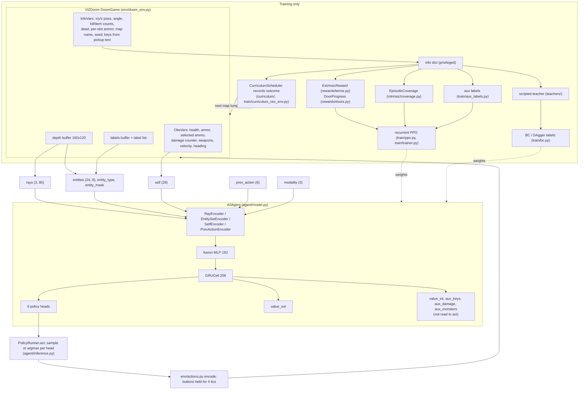

# DoomsDay architecture

Written 2026-11-25 from the code as it stood that evening. Where a decision record
(ADR in `docs/decisions/`, all still "Proposed") and the code disagree, this document
describes the code; the differences are listed in section 9. Every result number is
cited to a file in `reports/`.

## 1. Data flow

The two paths in `DoomEnv` are kept apart: `_build_obs` receives only `ObsVars` and
the sensor buffers; `_build_info` receives `InfoVars`. Nothing in `info` is an input
to the network.

## 2. Observation contract (`env/observation.py`, `env/doom_env.py`)

Screen 160 x 120, frame skip 4 (one decision = 4 tics), HUD rendered. Sensor settings
(frame skip, HUD, turn bins, entity cap, screen on/off) must be identical between the
training config and the evaluation config; `assert_same_sensors` enforces it and
`evaluate.run` calls it for every map.

| Key | Shape | Content |
|---|---|---|
| `rays` | (3, 80) float | For three row bands around the horizon (offsets -20..-4, -4..4, 4..20 rows), the nearest depth in each 2-pixel column, scaled to (0, 1]. Pixels of the player's weapon, its firing overlay and other depth-0 artefacts are excluded (`invalid_depth_mask`). 0.0 means "no valid reading in this cell". |
| `entities` | (24, 8) float | Per visible labelled object: `u, v` (screen-box centre, -1..1), `w, h` (box size), `d` (mean depth of the object's own pixels with valid depth), `du, dd` (change since last decision, matched by engine object id), `is_new`. |
| `entity_type` | (24,) int | Fixed table of 14 ids: pad, monster, projectile, health, armor, ammo, weapon, key-blue, key-yellow, key-red, other-pickup, decoration, unknown, hazard. From the engine's category and class name. |
| `entity_mask` | (24,) bool | Which rows are real. |
| `self` | (28,) float | health/100, armor/100, selected-weapon ammo, damage since last decision, selected weapon one-hot (10), owned weapons (10), ego-motion (4: forward, left, up speed, turn delta). |
| `prev_action` | (6,) int | The action executed at the previous decision. |
| `modality` | (3,) float | [telemetry present, screen enabled, ego-motion present]. |
| `screen` | (3, 60, 80) uint8 | Only if `screen_enabled`. Stage A0 trains with the screen off (`configs/a0_env.py`), and the A0 model has no screen encoder. |

Partial observability and filtering:
- Only labels with at least one pixel of their own value in the labels buffer get a
  row. A label with none (hidden behind the weapon or a nearer sprite) is dropped.
- When more than 24 entities are visible, the 24 nearest are kept.
- `objects_info` and `sectors_info` (whole-level lists) are off and refused under
  EVAL. No automap buffer is enabled.
- Absolute pose, absolute heading, map name, seed and keys held go to `info` only.

If telemetry is missing (for example under `+viz_nocheat 1`, which removes the depth
and labels buffers), rays, entities and ego-motion are zero-filled and `modality`
says so. The A0 agent has never been trained in that condition.

### 2.1 Observation v2 (TODO-VERIFY: in progress, not in the code)

A line-of-sight door channel and key bits are being added on the night of 2026-11-25.
At the time of writing, nothing in `env/` or `agent/` implements them. **TODO-VERIFY**:
after the change lands, document from the code:
- the shape and source of the door channel, and how line-of-sight is decided;
- where the key bits come from (the keys-held flags are today parsed from pickup
  messages and kept in `info` only);
- that both come from the unmodified engine and describe the world rather than
  pre-compute an action;
- the new obs spec. Checkpoints trained before v2 will not match it, and
  `evaluate.run` refuses a checkpoint whose obs spec differs from the env's.

## 3. Action space (`env/actions.py`)

Six independent categorical heads, applied unchanged for all 4 tics of a decision:

| Head | Values |
|---|---|
| move | none, forward, back |
| strafe | none, left, right |
| turn | 7 bins of TURN_LEFT_RIGHT_DELTA: -10, -4, -1, 0, 1, 4, 10 degrees per tic |
| attack | 0 / 1 |
| use | 0 / 1 (held; a new press is a 0 -> 1 change) |
| speed | 0 / 1 (run) |

No masking and no observation- or history-dependent logic sits between the network
output and the buttons.

## 4. Model (`agent/model.py`, `agent/encoders.py`, `configs/model_config.py`)

`A0Agent`, sizes from `ModelConfig`:

- `RayEncoder`: Conv1d 3 -> 16 -> 32 channels (kernel 5, stride 2, ReLU), flatten,
  linear to 64.
- `EntitySetEncoder`: type embedding (16) joined to the 8 features, shared MLP (64
  hidden) to 64-value tokens; a learned "no entity" token always present; one masked
  4-head self-attention block with residual and LayerNorm; a learned query pools the
  tokens with 4-head attention. Padded rows are zeroed and masked. No positional
  encoding, so the output does not depend on row order and any count from 0 to 24 is
  handled the same way. This is how the agent handles a variable number of enemies.
- `SelfEncoder`: MLP 28 -> 64 -> 32. `PrevActionEncoder`: one 16-value embedding table
  per head, summed.
- Fusion: concatenation of the four codes and `modality`, linear to 192, ReLU.
- Memory: `GRUCell(192, 256)`. The hidden state is zeroed before the first
  observation of each episode. This recurrent state is the agent's only memory across
  rooms; there is no map or external memory in the code.
- Heads on the GRU state: six policy heads (initial gain 0.01, near-uniform start),
  `value_ext`, and the training-only `value_int`, `aux_keys` (3 key bits),
  `aux_damage`, `aux_monsters`.

Stage A0 has 474,474 parameters (`reports/runs/2026-11-25-first-doom-run-a0-4x8.md`).

Inference: `PolicyRunner.act` (`agent/inference.py`) runs `model.step`, builds the
factorized categorical distribution, and takes per head either the sample or the
argmax. Which heads are argmax is a constant set at construction; in `evaluate.run`
it is all heads `--argmax` or all heads `--sample`.

Memory, measured on a synthetic task only (not DOOM),
`reports/runs/2026-11-25-adr0008-toy-gate-and-memory.md`: at a 4-step cue-to-answer
gap every recurrent seed scored 0.995-1.000 and every memoryless seed 0.450-0.560
(chance); at a 20-step gap all tested variants passed 8/8 seeds; at a 60-step gap arm
B1 passed 0/8 seeds and arm B2 0/4 seeds run, both at chance. The report concludes
that no long-horizon memory claim can be made.

## 5. Recurrent PPO (`train/`)

Our own implementation; no RL library is imported.

- **Collection** (`train/trainer.py`, `train/vec_env.py`, `train/subproc_vec_env.py`):
  worker processes each run several `DoomEnv`s; the main process runs the model and
  stores the GRU state at the start of each rollout (`train/rollout.py`).
- **Advantages**: GAE (`train/gae.py`), gamma 0.997, lambda 0.95. Returns are divided
  by a running return scale (`train/running_stats.py`).
- **Update** (`train/ppo.py`): minibatches are whole environment sequences, recomputed
  from the stored initial GRU state with the stored episode-start resets. Clipped
  policy loss (0.2), value loss (coefficient 0.5), entropy bonus 0.01 on the summed
  head entropies, gradient-norm clip 1.0, Adam lr 3e-4, 3 epochs, rollout 64.
- **Auxiliary losses** (`train/aux_labels.py`, weights 0.1 each): keys held, damage in
  the next 8 decisions, number of visible monsters. Labels come from `info`.
- **Imitation start**: `--init-from <bc_model.pt>` loads weights; the first
  `--value-warmup-updates N` updates train only the value and auxiliary heads.
- **Run safety** (`train/process_control.py`, `train/layout_guard.py`,
  `train/health_monitor.py`): below-normal priority, memory cap and low-memory stop,
  checkpoint every 600 s, resume, a guard against leftover engines, and a training
  health monitor that can flag or stop a run. These never touch actions.

Entry point: `python -m train.run_doom` (flags in `train/run_doom.py`); launch configs
in `configs/ops/` are started with `python -u -m configs.ops_launch <config> <run-dir>`.

## 6. Scripted teacher, imitation and DAgger (training only)

- **Teacher** (`teachers/navigator.py`, `teachers/controller.py`). From a generated
  map's WAD geometry: a 32-unit cell grid, an ordered list of anchors (start, key,
  each door with a stand-off and a pass point, exit), and a Dijkstra distance field per
  anchor. Each decision the controller reads the privileged pose from `info` and the
  previous action, and returns an action in the agent's six-head space: pursue the
  route, at doors approach / align / press USE / push through, unstick when blocked.
  Attack is always 0 (no combat teacher).
- **Collection** (`teachers/collect.py`): teacher episodes on the TRAIN maps with
  random noise bursts executed while the teacher's label is recorded. In DAgger mode
  (`--student`), the student checkpoint drives through `PolicyRunner`, with probability
  `--beta` the teacher's action is executed instead, and the teacher labels every state.
- **Behaviour cloning** (`train/bc.py`): the same `A0Agent`, per-head cross-entropy,
  truncated backpropagation through time over 64-decision chunks with a carried GRU
  state. Validation is split by map id. Default head weights are all 1
  (`configs/bc_config.py`).
- **Isolation**: `tests/test_teachers_isolation.py` fails if any module under
  `agent/`, `env/` or `evaluate/` imports `teachers`.

Measured outcome (`reports/eval/2026-11-25-bc-dagger.md`): plain BC was no better than
random in closed loop; DAgger round 1 reached 18/40 on TRAIN S0 maps and 6/15 on val
S0 (not significant against random 3/15 on val); rounds 2-3 did not improve; doors
stayed near zero because the teacher's USE labels are rare.

## 7. Rewards and exploration (training only)

All of this code reads `info` only and returns a reward; it never sees or changes the
action or the observation. `rewards/factory.py` refuses to wrap a vanilla-eval config.

**Extrinsic terms** (`rewards/terms.py`, scales in `configs/reward_config.py`, preset
`full_level`):

| Term | Scale | Guard |
|---|---|---|
| level exit | 1.0 | paid only if the final engine reward confirms the exit |
| keycard | 0.1 per colour | once per colour per episode |
| kill | 0.02 | capped (below) |
| damage taken | -0.003 per point | one source per step |
| health gained | 0.002 per point | capped |
| ammo gained | 0.005 per 10 units | per-step clip, capped |
| armor gained | 0.001 per point | capped |
| death | -0.75 | |
| time | -0.0002 per decision | |

The positive pay of kill, health, ammo and armor is capped at 0.4 per episode.
`rewards/validate.py` refuses a setup in which not exiting could earn more than
exiting.

**Door term** (`rewards/doors.py`, preset `full_level_doors`, scale 0.3): paid once
per door per episode, the first time the player is seen on the far side of a door
without leaving the region around it. Uses the pose and the door geometry of the
generated map (`maps/doors.py`).

**Coverage bonus** (`intrinsic/coverage.py`, `CoverageConfig`): a 128-unit grid over
the map; the first visit to a cell in an episode pays 1/64, for at most 64 cells; the
start cell pays nothing; heading is not part of the cell. The coefficient starts at
0.25 and falls linearly to 0.05 over 60,000 decisions per environment. The bonus is
summed into the reward (`sum_intrinsic_into_reward = True`), so `value_int` is unused.
A learned novelty module (`intrinsic/learned_novelty.py`) is described as not built.

No ablation of these terms has been measured.

## 8. Maps and curriculum (training only)

- **Generator** (`maps/generator.py`, our own): seeded; rectangular rooms grown as a
  tree on a 32-unit lattice along corridors, optional loops; start in room 0, exit in
  the deepest leaf; for keyed stages a locked door on the start-to-exit path and the
  key in a side branch. Output is a vanilla Doom-format PWAD with empty node lumps (the
  engine builds nodes); DR doors, keyed DR doors, W1 exit line, S1 exit switch; no ACS.
  Same inputs give a byte-identical WAD.
- **QA** (`maps/qa/validate.py`): structure checks, reachability search (for keyed
  stages: exit unreachable without the key), and engine checks.
- **Splits** (`maps/splits.json`, `maps/loader.py`): batch 1 has 80 train, 20 val and
  20 held-out maps, 5 or 20 per stage (S0 navigation, S1 doors, S2 key and locked door,
  S3 monsters and pickups) (`reports/runs/2026-11-25-maps-batch1.md`). The loader
  refuses held-out maps for training by split, path and hash; the env refuses
  `heldout_maps/` and map names absent from the training PWAD.
- **Curriculum** (`curriculum/scheduler.py`, `curriculum/config.json`,
  `train/curriculum_vec_env.py`): the agent trains on its current stage; when the last
  200 episodes on that stage reach the threshold (S0 0.6, S1 0.6, S2 0.5) it is
  promoted; after a promotion 20% of episodes replay an earlier stage. Maps within a
  stage are visited in a shuffled cycle. The stage and map id are logged and never
  enter the observation. The config file states these thresholds are unmeasured.
- Known limits of batch 1 (`reports/runs/2026-11-25-maps-batch1.md`): only 4 of 120
  maps have loops, walls are axis-aligned, monsters are Zombieman, ShotgunGuy and Imp
  only, one player start per map.

## 9. Differences between the ADRs and the code

- ADR 0003 plans Stage A1 (a pixel CNN branch) and Stage B (an ego-centric learned map
  memory). Neither is in the code; the agent is Stage A0 with the GRU as its only
  memory.
- ADR 0005 plans a separate intrinsic value head and a learned novelty bonus (E2). The
  code sums the coverage bonus into the extrinsic reward; `value_int` exists but is
  not trained by PPO; `intrinsic/learned_novelty.py` says not built.
- ADR 0005's curriculum ladder lists bundled `health_gathering` and `deadly_corridor`
  scenarios; only `my_way_home` and the generated maps are wired into training.
- `reports/eval/2026-11-25-bc-dagger.md` says the BC attack-head weight default is
  still 0; `configs/bc_config.py` now sets it to 1.
- The scripted teacher (CLAUDE.md section 7, 2026-11-25 evening plan change) is not
  covered by any ADR.
